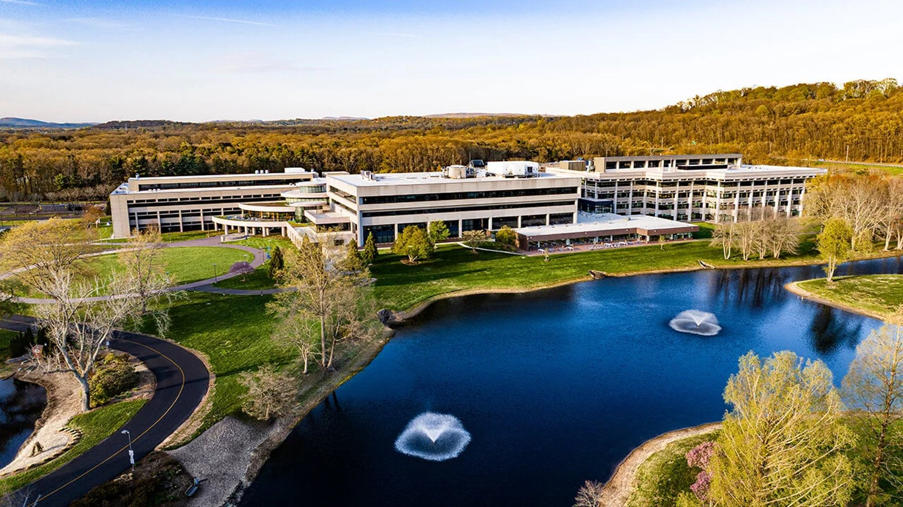

    <h1 class="ct-title">Contact</h1>

    

        

            
Paul Wolujewicz, PhD, MPH

            

                Assistant Professor of Medical Sciences, <a href="https://medicine.qu.edu/" target="_blank" rel="noopener">Frank H. Netter MD School of Medicine</a>, Quinnipiac University. Joint appointment in Biomedical Sciences, <a href="https://www.qu.edu/schools/health-sciences/" target="_blank" rel="noopener">School of Health Sciences</a>.
            

            

                
Email

                
<a href="mailto:paul.wolujewicz@quinnipiac.edu">paul.wolujewicz@quinnipiac.edu</a>

            

            

                
Office

                
MNH-302H North Haven Campus

            

            

                
Mailing address

                

                    Quinnipiac University 
                    Frank H. Netter MD School of Medicine 
                    370 Bassett Road 
                    North Haven, CT 06473
                

            

            

                Students interested in research with the lab, and colleagues interested in collaboration, are welcome to get in touch by email.
            

        

        <figure class="ct-figure">
            
            
North Haven Campus, Quinnipiac University

        </figure>

    

